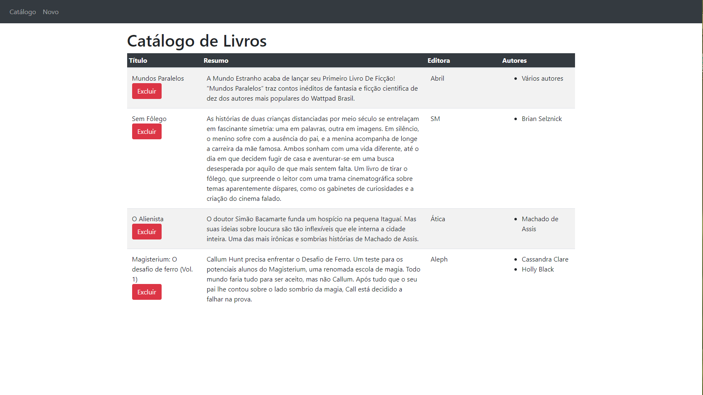
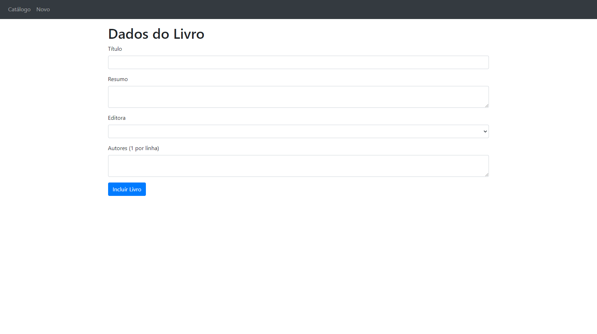
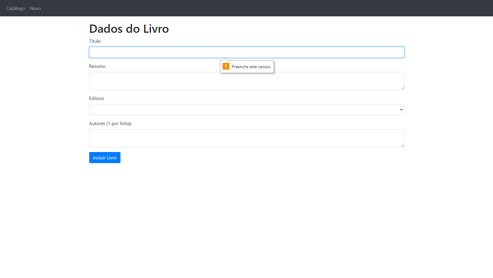

# Catálogo de Livros — Express, MongoDB e Front-ends

Missão Prática RPG0012, Mundo 2, Nível 5, do curso de Desenvolvimento Full Stack da Estácio.

**Autor indicado no projeto:** Lucas Alves Vieira da Silva.

O exercício integra uma API de livros com clientes React, Next.js e Angular.

## Componentes

| Pasta | Tecnologias declaradas | Inicialização |
| --- | --- | --- |
| `livro-servidor/` | Express 4, Mongoose 8, EJS | `npm start` |
| `clientes/livros-react/` | React 18, TypeScript 4, React Scripts 5 | `npm start` |
| `clientes/livros-next/` | Next.js 13.2.4, React 18 | `npm run dev` |
| `clientes/livros-angular/` | Angular 17.3, TypeScript 5.4 | `npm start` |

## Preparação

Use Git, Node.js com npm e MongoDB. Os `package.json` consultados não fixam a versão de Node em `engines`; cada componente tem suas próprias dependências.

```sh
git clone https://github.com/alvesvslucas/Nivel-5-Mundo-2.git
cd Nivel-5-Mundo-2
```

Prepare uma instância local do MongoDB e ajuste a conexão de desenvolvimento usada por `livro-servidor/modelo/conexao.js`, sem publicar credenciais.

## Executar

Inicie a API a partir da raiz:

```sh
cd livro-servidor
npm install
npm start
```

O servidor usa `PORT` ou, por padrão, a porta **3030**; as rotas de livros ficam em `/livros`. Os clientes React e Angular consultados apontam para `http://localhost:3030/livros`.

Em outro terminal, a partir da raiz, escolha **um** cliente:

```sh
cd clientes/livros-react
npm install
npm start
```

Para as outras versões, entre na pasta correspondente da tabela, execute `npm install` e o comando de inicialização indicado. Use o endereço mostrado no terminal. React e Next.js podem disputar a mesma porta quando iniciados juntos.

## Build e estado

Os três clientes possuem `npm run build`; React e Angular possuem `npm test`, e Next.js possui `npm run lint`. O servidor não declara script de testes. Instalação, banco, integração e builds não foram executados nesta revisão.

## Imagens




